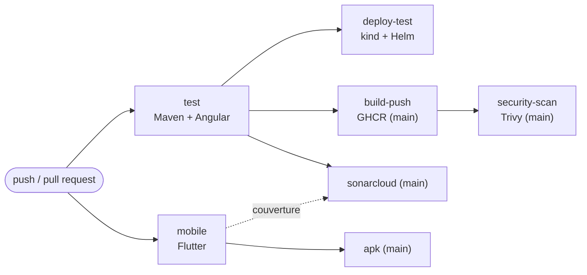

# Pipeline CI/CD (GitHub Actions)

Fichier : [`.github/workflows/ci-cd.yml`](../.github/workflows/ci-cd.yml). Tout s'exécute sur les machines virtuelles de GitHub (« runners » Ubuntu, gratuits pour un dépôt public) : rien n'est installé ni lancé sur le poste de développement.



| Job | Quand | Rôle |
|---|---|---|
| `test` | toujours | Tests backend (Maven, cache `~/.m2`), build de production et tests Angular |
| `mobile` | toujours | Analyse statique et tests Flutter (application hors Kubernetes) |
| `deploy-test` | toujours, après `test` | Construit les images dans le runner, crée un cluster **kind** jetable (Kubernetes 1.36), `helm install` avec des secrets factices générés, `kubectl wait`, `/actuator/health` via port-forward, `helm test`. **Le pipeline échoue si l'application ne démarre pas vraiment dans Kubernetes.** En cas d'échec : ressources, events, `describe` et logs de chaque pod sont affichés |
| `build-push` | `main` uniquement | Construit et pousse `ghcr.io/fotso12/carrefourconnect-backend` et `-frontend`, tags **SHA court** (ex. `70edde6`) et **`latest`** |
| `security-scan` | `main`, après `build-push` | **Trivy** : échec si une vulnérabilité CRITICAL a un correctif ; les HIGH sont listées sans bloquer |
| `sonarcloud` | `main` | Qualité de code et couverture (backend, web, mobile) |
| `apk` | `main` | APK Android en artefact téléchargeable |
| `release` | tag `v*.*.*` | Après `deploy-test` et `security-scan` : vérifie que le tag correspond à `Chart.yaml`, empaquette le chart Helm et crée la **GitHub Release** (notes tirées de `CHANGELOG.md`, chart en pièce jointe) |

Déclencheurs : `push` sur `main` et `feat/**`, `push` d'un tag `v*.*.*`, `pull_request` vers `main`, et le bouton **Run workflow** (`workflow_dispatch`).

## Publier une version

Numérotation [SemVer](https://semver.org/lang/fr/) `MAJEUR.MINEUR.CORRECTIF` : CORRECTIF pour une correction, MINEUR pour une fonctionnalité compatible, MAJEUR pour un changement incompatible (en `0.x`, l'API n'est pas encore figée).

1. Sur une branche : mettre la même version dans `backend/pom.xml`, `frontend-web/package.json` (`npm version X.Y.Z --no-git-tag-version`) et `deploy/helm/carrefourconnect/Chart.yaml` (`version` et `appVersion`), et ajouter la section `## [X.Y.Z]` dans `CHANGELOG.md`.
2. Pull request, pipeline vert, fusion dans `main`.
3. Poser le tag sur le commit de `main` et le pousser :

   ```powershell
   git switch main; git pull
   git tag -a vX.Y.Z -m "CarrefourConnect vX.Y.Z"
   git push origin vX.Y.Z
   ```

4. Le pipeline publie les images `ghcr.io/fotso12/carrefourconnect-*:X.Y.Z` (et `X.Y`), puis la release apparaît dans l'onglet **Releases** du dépôt. Un nouveau push sur une branche annule l'exécution précédente encore en cours (`concurrency`).

## Choix techniques

- **`GITHUB_TOKEN`** : jeton temporaire créé par GitHub pour chaque exécution, détruit à la fin. Rien à stocker pour GHCR. Par défaut il ne peut que lire le dépôt (`permissions: contents: read`) ; seul `build-push` reçoit `packages: write` (principe du moindre privilège).
- **Tags d'images** : le SHA court dit exactement quel commit tourne et ne change jamais (rollback fiable) ; `0.2.0` nomme une version publiée ; `latest` (dernière version de `main`) est pratique mais mobile. En production, on déploie toujours un tag immuable (SHA ou version).
- **Images construites deux fois** (dans `deploy-test` et `build-push`) : `deploy-test` doit aussi tourner sur les pull requests, qui n'ont pas le droit de pousser sur le registre. Le cache BuildKit partagé (`type=gha`) rend le second build quasi instantané.
- **kind dans la CI, k3d en local** : deux façons de faire tourner Kubernetes dans Docker. kind est l'outil de référence des tests en CI (utilisé pour tester Kubernetes lui-même) ; même version de Kubernetes (1.36) et même chart Helm dans les deux cas.
- **Actions tierces épinglées par SHA** (`aquasecurity/trivy-action@ed142fd…  # v0.36.0`) : un tag peut être déplacé par un attaquant qui compromet le dépôt de l'action ; un SHA de commit, non.
- **`ignore-unfixed`** : une faille sans correctif disponible ne bloque pas le pipeline (on ne peut rien y faire), mais elle reste visible dans le rapport.

## Lire les logs d'un job (onglet Actions)

1. Sur GitHub, dépôt **CarrefourConnect** → onglet **Actions**.
2. À gauche, le workflow **CI/CD** ; au centre, la liste des exécutions (une par push), avec le message du commit et la branche.
3. Cliquer sur une exécution : le **graphe des jobs** s'affiche (vert ✓, rouge ✗, gris = ignoré, par exemple `build-push` sur une branche autre que `main`).
4. Cliquer sur un job : chaque **étape** se déplie ; l'étape en échec est ouverte automatiquement, avec la ligne d'erreur. Les blocs `::group::` du diagnostic (`describe`, `logs`...) se déplient d'un clic.
5. En haut à droite : **Re-run jobs** (relancer tout ou seulement les jobs en échec), et la roue dentée → *View raw logs* / *Download log archive*.
6. En bas de la page de l'exécution : les **artefacts** (rapports de couverture, APK) à télécharger.

En ligne de commande avec GitHub CLI :

```powershell
gh run list --workflow ci-cd.yml --limit 5          # dernières exécutions
gh run watch                                         # suivre l'exécution en cours, en direct
gh run view <id>                                     # résumé : jobs et statut
gh run view <id> --log-failed                        # uniquement les logs des étapes en échec
gh run rerun <id> --failed                           # relancer les jobs en échec
gh run download <id> -n carrefourconnect-android-apk # télécharger un artefact
```

## Images GHCR : publiques ou privées

Les images apparaissent dans **Packages** : sur le profil (https://github.com/Fotso12?tab=packages) et dans la colonne de droite du dépôt.

- À sa première publication, un paquet est **privé** : seuls toi et les workflows du dépôt peuvent le télécharger.
- **Le rendre public** (n'importe qui peut faire `docker pull`, sans compte) : page du paquet → **Package settings** → *Danger Zone* → **Change visibility** → *Public*. Attention : un paquet public ne peut plus redevenir privé.
- **Le garder privé** et le télécharger depuis un cluster : créer un jeton GitHub (*Settings → Developer settings → Personal access tokens*, permission `read:packages`), puis un Secret Docker dans le namespace et le référencer dans le chart :

  ```powershell
  kubectl -n carrefourconnect create secret docker-registry ghcr-credentials `
    --docker-server=ghcr.io --docker-username=Fotso12 --docker-password=<jeton>
  # puis dans un fichier de valeurs : backend.imagePullSecrets: [{ name: ghcr-credentials }]
  ```

- Dans **Package settings** → *Manage Actions access*, vérifier que le dépôt CarrefourConnect a le rôle **Write** (normalement automatique, grâce au label `org.opencontainers.image.source` posé par le pipeline).

Télécharger une image publiée :

```powershell
docker pull ghcr.io/fotso12/carrefourconnect-backend:latest
```
