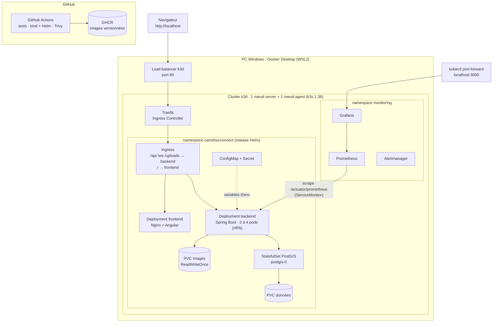

# Déploiement de CarrefourConnect

Ce dossier contient tout ce qu'il faut pour faire tourner CarrefourConnect **en local** : avec Docker Compose (le plus simple), puis sur un **cluster Kubernetes** k3d avec **Helm**, avec la **supervision** Prometheus/Grafana. Le pipeline **GitHub Actions** teste, publie et vérifie le déploiement à chaque modification.

| Dossier / fichier | Contenu |
|---|---|
| [`SETUP.md`](SETUP.md) | Installation du poste (Windows) : outils, versions, commandes, erreurs rencontrées |
| [`docker-compose.yml`](docker-compose.yml), [`nginx/`](nginx), [`.env.example`](.env.example) | Toute l'application avec Docker Compose |
| [`scripts/`](scripts) | Création / arrêt du cluster k3d (`cluster-up`, `cluster-down`, PowerShell et bash) |
| [`k8s/`](k8s/README.md) | Manifests Kubernetes écrits à la main (référence pédagogique) |
| [`helm/carrefourconnect/`](helm/carrefourconnect/README.md) | **Chart Helm** : la façon de déployer l'application |
| [`monitoring/`](monitoring/README.md) | Supervision : kube-prometheus-stack, dashboard, HPA |
| [`load-test/`](load-test/charge.js) | Test de charge k6 |
| [`CI-CD.md`](CI-CD.md) | Pipeline GitHub Actions, images GHCR, releases |
| [`ENTRETIEN.md`](ENTRETIEN.md) | Fiche de révision : concepts et questions d'entretien |

## Architecture



- Le navigateur ne connaît qu'**une adresse** (`http://localhost`) : l'Ingress envoie `/api`, `/ws` (WebSocket) et `/uploads` au backend, le reste au frontend. Le frontend appelle donc l'API en **chemins relatifs**, sans CORS.
- Le **backend** est sans état (authentification par JWT) : ses pods sont interchangeables et le HPA peut en ajouter. La **base** est dans un StatefulSet avec son propre volume.
- `/actuator` n'est pas exposé à l'extérieur : seuls Kubernetes (sondes) et Prometheus l'interrogent, depuis l'intérieur du cluster.

## Prérequis

Windows 10/11 avec Docker Desktop (moteur WSL2), Git, kubectl, k3d, Helm, et JDK 25 + Node 24 pour développer. Tout est détaillé, avec les commandes d'installation et de vérification, dans **[`SETUP.md`](SETUP.md)**.

## Démarrage local

### 1. Docker Compose (le plus simple)

```powershell
Copy-Item deploy\.env.example deploy\.env        # puis remplir POSTGRES_PASSWORD et JWT_SECRET
docker compose -f deploy/docker-compose.yml up -d --build
docker compose -f deploy/docker-compose.yml ps    # les 3 services passent "healthy"
```

Application : http://localhost:8080

### 2. Kubernetes : k3d + Helm

```powershell
# Cluster (1 server + 1 agent, port 80 relié à Traefik)
.\deploy\scripts\cluster-up.ps1

# Images construites en local puis importées dans le cluster (pas de registre)
docker build -t carrefourconnect-backend:dev backend
docker build -t carrefourconnect-frontend:dev frontend-web
k3d image import carrefourconnect-backend:dev carrefourconnect-frontend:dev -c carrefourconnect

# Secrets (une fois) puis installation
$c = "deploy\helm\carrefourconnect"
Copy-Item $c\values-secret.example.yaml $c\values-secret.yaml   # puis le remplir
helm install carrefourconnect $c -n carrefourconnect --create-namespace `
  -f $c\values-dev.yaml -f $c\values-secret.yaml --wait --timeout 6m
helm test carrefourconnect -n carrefourconnect
```

Application : http://localhost. Cycle de vie (`upgrade`, `history`, `rollback`) : [chart Helm](helm/carrefourconnect/README.md).

Les images publiées par la CI peuvent aussi être utilisées à la place des images locales : `--set backend.image.repository=ghcr.io/fotso12/carrefourconnect-backend --set backend.image.tag=0.2.0` (idem pour le frontend).

### 3. Supervision

```powershell
helm repo add prometheus-community https://prometheus-community.github.io/helm-charts
helm upgrade --install monitoring prometheus-community/kube-prometheus-stack --version 93.9.0 `
  -n monitoring --create-namespace -f deploy/monitoring/kube-prometheus-stack-values.yaml --wait --timeout 10m
```

Le ServiceMonitor, le dashboard et le HPA sont activés par `values-dev.yaml` (refaire le `helm upgrade` de l'application si elle était installée avant la supervision).

## Accès à Grafana

```powershell
# Mot de passe de l'utilisateur "admin"
$b64 = kubectl -n monitoring get secret monitoring-grafana -o jsonpath="{.data.admin-password}"
[Text.Encoding]::UTF8.GetString([Convert]::FromBase64String($b64))

kubectl -n monitoring port-forward svc/monitoring-grafana 3000:80
```

http://localhost:3000 → dossier **CarrefourConnect** → **CarrefourConnect - Backend**. Pour animer les graphiques :

```powershell
Get-Content deploy\load-test\charge.js | docker run --rm -i -e BASE_URL=http://host.docker.internal grafana/k6:2.4.0 run -
```

Lecture de chaque graphique : [monitoring/README.md](monitoring/README.md).

## Pipeline CI/CD

À chaque push : tests backend et Angular, analyse et tests Flutter, puis **test de déploiement** (cluster kind créé dans le runner, `helm install`, attente des pods, `/actuator/health`, `helm test`). Sur `main` : images publiées sur **GHCR**, scan **Trivy**, SonarCloud, APK. Sur un tag `vX.Y.Z` : **release** GitHub avec le chart Helm. Détails : [CI-CD.md](CI-CD.md).

```powershell
gh run list --workflow ci-cd.yml --limit 5
gh run view <id> --log-failed
```

## Dépannage courant

| Symptôme | Cause probable | Solution |
|---|---|---|
| `kubectl` : `Unable to connect to the server` | Cluster arrêté (redémarrage du PC) ou mauvais contexte | `.\deploy\scripts\cluster-up.ps1` ; `kubectl config current-context` doit afficher `k3d-carrefourconnect` |
| Pod en `ImagePullBackOff` | Image locale non importée, ou `-f values-dev.yaml` oublié (le chart cherche alors les images GHCR) | `k3d image import ...` ; toujours repasser les mêmes `-f` à `helm upgrade` |
| Pod en `CrashLoopBackOff` | L'application plante au démarrage | `kubectl -n carrefourconnect logs <pod> --previous` |
| Pod `Running` mais `0/1` | readinessProbe en échec (démarrage en cours, base indisponible) | `kubectl -n carrefourconnect describe pod <pod>` (section Events) |
| Backend en `Init:0/1` | L'initContainer attend PostGIS | `kubectl -n carrefourconnect logs <pod> -c attendre-postgis` ; état de `carrefourconnect-postgis-0` |
| `http://localhost` répond 404 | Aucun Ingress déployé (Traefik répond seul) | `helm list -n carrefourconnect` ; `kubectl -n carrefourconnect get ingress` |
| `helm upgrade` échoue (`not ready`) | Un pod de la nouvelle version ne démarre pas | Diagnostiquer avec `logs` / `describe`, puis `helm rollback carrefourconnect <révision>` |
| Images envoyées en erreur | Volume des uploads absent ou pod sur un autre nœud | `kubectl -n carrefourconnect get pvc` ; les pods backend doivent être sur le même nœud |
| Grafana vide | Application installée avant la supervision, ou namespace non sélectionné | `helm upgrade` de l'application ; choisir le namespace `carrefourconnect` en haut du dashboard |
| Tout est lent | RAM de WSL saturée | `docker stats` ; `cluster-down.ps1 -StopOnly` pour libérer la mémoire ; voir `.wslconfig` dans SETUP.md |

Commandes de diagnostic essentielles :

```powershell
kubectl -n carrefourconnect get pods -o wide
kubectl -n carrefourconnect describe pod <pod>
kubectl -n carrefourconnect logs <pod> [-c <conteneur>] [--previous]
kubectl -n carrefourconnect get events --sort-by=.lastTimestamp
kubectl -n carrefourconnect top pods
```

## Limites connues

- **Notifications WebSocket** : le broker STOMP de Spring est en mémoire dans chaque pod ; une notification n'est poussée en temps réel qu'aux clients connectés au même pod (elle reste visible au rafraîchissement). Évolution prévue : broker partagé (Redis pub/sub).
- **Images envoyées** sur un volume `ReadWriteOnce` : tous les pods backend sont sur le même nœud. En production : stockage objet (S3/MinIO).
- **Schéma de base** géré par `ddl-auto=update` : pas de migrations versionnées (Flyway serait la solution de production).
- **Historique Git** : une ancienne clé JWT par défaut figure dans les commits antérieurs à la v0.2.0. Elle a été retirée du code, n'est utilisée nulle part et doit être considérée comme compromise ; la clé vient désormais obligatoirement d'un Secret (`JWT_SECRET`).
