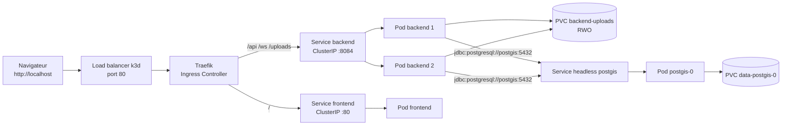

# Manifests Kubernetes bruts

Déploiement de CarrefourConnect sur le cluster k3d local (namespace `carrefourconnect`), avec des fichiers YAML écrits à la main. L'étape suivante les transformera en chart Helm.

| Fichier | Contenu |
|---|---|
| `00-namespace.yaml` | Namespace `carrefourconnect` |
| `10-configmap.yaml` | Configuration non sensible (URL de la base, SMTP, URL publique...) |
| `secret.example.yaml` | **Modèle** du Secret (mots de passe, clé JWT). Le vrai `secret.yaml` est ignoré par Git |
| `20-postgis.yaml` | PostgreSQL/PostGIS : Service headless + StatefulSet (+ PVC via `volumeClaimTemplates`) |
| `30-backend.yaml` | Backend : PVC des images + Deployment (2 réplicas, 3 sondes, rolling update) + Service ClusterIP |
| `40-frontend.yaml` | Frontend : Deployment Nginx + Service ClusterIP |
| `50-ingress.yaml` | Ingress Traefik : `/api`, `/ws`, `/uploads` vers le backend, `/` vers le frontend |
| `kustomization.yaml` | Liste des fichiers appliqués par `kubectl apply -k` (sans le Secret) |



## Déployer (PowerShell, depuis la racine du dépôt)

Prérequis : le cluster tourne (`.\deploy\scripts\cluster-up.ps1`).

```powershell
# 1. Construire les images (comme pour Docker Compose)
docker build -t carrefourconnect-backend:dev backend
docker build -t carrefourconnect-frontend:dev frontend-web

# 2. Les importer dans le cluster : les nœuds k3d n'ont pas accès aux images de ton Docker,
#    et il n'y a pas de registre local. k3d les copie dans le containerd de chaque nœud.
k3d image import carrefourconnect-backend:dev carrefourconnect-frontend:dev -c carrefourconnect

# 3. Le Secret (une seule fois) : copier le modèle, mettre de vraies valeurs, l'appliquer
Copy-Item deploy\k8s\secret.example.yaml deploy\k8s\secret.yaml
notepad deploy\k8s\secret.yaml
kubectl apply -f deploy\k8s\00-namespace.yaml
kubectl apply -f deploy\k8s\secret.yaml

# 4. Tout le reste
kubectl apply -k deploy\k8s

# 5. Attendre que tout soit prêt (~1 à 2 minutes)
kubectl -n carrefourconnect rollout status statefulset/postgis
kubectl -n carrefourconnect rollout status deployment/backend
kubectl -n carrefourconnect get pods -o wide
```

Application : **http://localhost** (Docker Compose, lui, reste sur http://localhost:8080).

> Après avoir reconstruit une image avec le **même tag** `:dev`, il faut la réimporter puis redémarrer les pods : `kubectl -n carrefourconnect rollout restart deployment/backend`. Le cluster ne « voit » pas qu'une image locale a changé.

Supprimer l'application (le Secret et le disque de PostGIS sont conservés) : `kubectl delete -k deploy\k8s`. Tout effacer : `kubectl delete namespace carrefourconnect`.

## Exercices

### 1. Rolling update (mise à jour sans coupure)

Dans un **premier** terminal, envoyer une requête toutes les 0,2 s et afficher le code HTTP :

```powershell
while ($true) { try { $c = (Invoke-WebRequest -UseBasicParsing http://localhost/api/categories -TimeoutSec 5).StatusCode } catch { $c = "ERREUR" }; "$(Get-Date -Format HH:mm:ss.fff)  $c"; Start-Sleep -Milliseconds 200 }
```

Dans un **second** terminal :

```powershell
kubectl -n carrefourconnect get pods -w          # observer en direct (Ctrl+C pour arrêter)
```

Dans un **troisième** terminal, déclencher une nouvelle version :

```powershell
# a) redémarrage simple (même image) : crée une nouvelle "révision"
kubectl -n carrefourconnect rollout restart deployment/backend

# b) ou une vraie nouvelle version : nouveau tag, import, mise à jour de l'image
docker tag carrefourconnect-backend:dev carrefourconnect-backend:v2
k3d image import carrefourconnect-backend:v2 -c carrefourconnect
kubectl -n carrefourconnect set image deployment/backend backend=carrefourconnect-backend:v2

kubectl -n carrefourconnect rollout status deployment/backend
kubectl -n carrefourconnect rollout history deployment/backend
kubectl -n carrefourconnect rollout undo deployment/backend      # revenir à la version précédente
```

> `set image` et `rollout undo` sont des commandes **impératives** : elles modifient le cluster sans toucher aux fichiers YAML. Kubernetes le signale (`Warning: resource deployments/backend was previously managed with 'kubectl apply'`). Le prochain `kubectl apply -k` remettra ce qui est écrit dans les fichiers. Bonne pratique : les fichiers (dans Git) sont la source de vérité ; les commandes impératives servent à expérimenter ou à dépanner en urgence. C'est la base de l'approche GitOps.

À observer : un 3e pod apparaît (`maxSurge: 1`), passe `0/1` → `1/1` en ~25 s, **puis seulement** un ancien pod passe en `Terminating` (`maxUnavailable: 0`). Le premier terminal n'affiche que des `200`. Mesuré : 410 requêtes, 410 réponses 200.

### 2. Supprimer un pod : Kubernetes le recrée

```powershell
kubectl -n carrefourconnect get pods
kubectl -n carrefourconnect delete pod <nom-d-un-pod-backend>
kubectl -n carrefourconnect get pods -w
```

Le Deployment constate qu'il n'y a plus que 1 pod au lieu de 2 et en crée un nouveau, **avec un autre nom** (mesuré : prêt en ~20 s). Pendant ce temps, l'autre pod continue de répondre.

Même chose avec la base : `kubectl -n carrefourconnect delete pod postgis-0`. Le StatefulSet recrée un pod **avec le même nom** `postgis-0`, rattaché au **même disque** : les données sont toujours là. Pendant les quelques secondes de redémarrage, les sondes readiness des backends échouent (la base fait partie de la readiness) : ils sont retirés du trafic, **sans être redémarrés**, puis reviennent seuls.

## Commandes de diagnostic

| Commande | À quoi elle sert |
|---|---|
| `kubectl -n carrefourconnect get pods -o wide` | État des pods, nœud, IP, nombre de redémarrages |
| `kubectl -n carrefourconnect get pods -w` | Suivre les changements en direct |
| `kubectl -n carrefourconnect describe pod <pod>` | Détails + **Events** en bas : image introuvable, sonde en échec, OOMKilled, pas de nœud disponible... |
| `kubectl -n carrefourconnect logs <pod>` | Logs du conteneur (stdout). `-f` pour suivre, `--previous` pour le conteneur précédent après un crash |
| `kubectl -n carrefourconnect logs <pod> -c attendre-postgis` | Logs d'un conteneur précis (ici l'initContainer) |
| `kubectl -n carrefourconnect logs deploy/backend` | Logs d'un des pods du Deployment |
| `kubectl -n carrefourconnect get events --sort-by=.lastTimestamp` | Chronologie de tout ce qui s'est passé dans le namespace |
| `kubectl -n carrefourconnect exec -it <pod> -- sh` | Ouvrir un shell dans le conteneur |
| `kubectl -n carrefourconnect top pods` | CPU et mémoire réellement utilisés (metrics-server) |
| `kubectl -n carrefourconnect get endpointslices` | Quels pods le Service considère comme prêts |
| `kubectl -n carrefourconnect port-forward svc/backend 8084:8084` | Accéder directement au backend (ex. `/actuator/health`) depuis le PC |

Lire le statut d'un pod :

| Statut | Signification probable |
|---|---|
| `Init:0/1` | L'initContainer attend (ici : PostGIS pas prêt). Voir ses logs avec `-c attendre-postgis` |
| `ContainerCreating` | Téléchargement de l'image ou montage du volume |
| `Running` mais `0/1` | Le conteneur tourne mais la readinessProbe échoue (démarrage, base indisponible) |
| `ErrImagePull` / `ImagePullBackOff` | Image introuvable : oubli de `k3d image import`, ou tag `latest` (Kubernetes tente alors de télécharger) |
| `CrashLoopBackOff` | Le conteneur plante en boucle : `kubectl logs <pod> --previous` |
| `OOMKilled` (dans `describe`) | Limite mémoire dépassée : augmenter `limits.memory` |
| `Pending` | Aucun nœud n'a assez de ressources (requests) ou le volume n'est pas disponible : voir `describe` |

## Choix techniques et limites connues

- **Images envoyées (`/app/uploads`)** : un volume `ReadWriteOnce` de `local-path`. Ce stockage épingle le volume sur un nœud, donc Kubernetes place les deux pods backend sur ce nœud et ils partagent les fichiers. Limite : si ce nœud tombe, les deux pods tombent. En production : stockage objet (S3/MinIO) ou volume `ReadWriteMany`.
- **Notifications WebSocket avec 2 réplicas** : le backend utilise le *simple broker* STOMP de Spring (`enableSimpleBroker`), qui vit dans la mémoire de chaque pod. Une notification déclenchée sur le pod A n'est poussée qu'aux navigateurs connectés au pod A. Les notifications restent enregistrées en base et s'affichent au prochain rafraîchissement, mais le temps réel n'est garanti que pour les clients du même pod. Solution en production : un broker externe partagé (RabbitMQ via `enableStompBrokerRelay`, ou Redis pub/sub).
- **Sessions sticky** (annotations Traefik sur le Service backend) : nécessaires pour les modes de repli de SockJS (plusieurs requêtes HTTP qui doivent arriver au même pod). Elles n'affectent pas l'API REST, qui est sans état (JWT).
- **Sécurité des pods backend** : utilisateur non-root 1001, système de fichiers racine en lecture seule (seuls `/app/uploads` et `/tmp` sont inscriptibles), aucune capability Linux, profil seccomp par défaut.
- **`/actuator`** n'est pas exposé par l'Ingress : seuls le kubelet (sondes) et, plus tard, Prometheus y accèdent, depuis l'intérieur du cluster.
