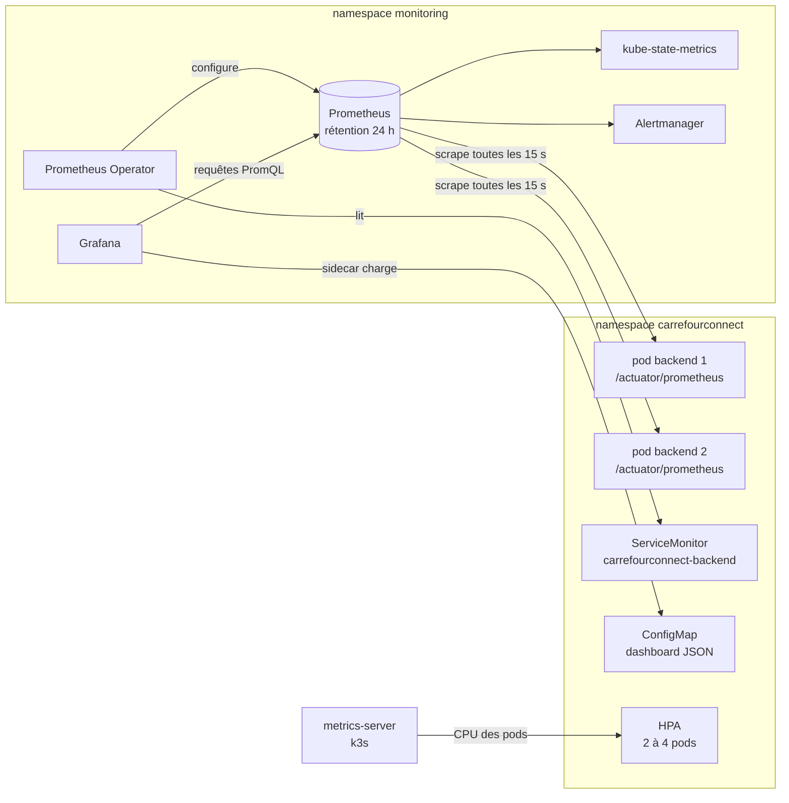

# Supervision : Prometheus + Grafana (kube-prometheus-stack)

Toute la supervision tourne **dans le cluster k3d local**, dans le namespace `monitoring`, et n'est accessible que depuis ce PC (`kubectl port-forward`, aucune exposition par l'Ingress).



| Élément | Rôle |
|---|---|
| **Micrometer** (dans le backend) | Mesure les requêtes HTTP, la JVM, la base, et les expose au format Prometheus sur `/actuator/prometheus` |
| **Prometheus** | Va **chercher** (« scrape ») les métriques toutes les 15 s et les stocke en séries temporelles |
| **Prometheus Operator** | Configure Prometheus à partir d'objets Kubernetes, notamment les **ServiceMonitor** |
| **ServiceMonitor** (chart `carrefourconnect`) | « Collecte `/actuator/prometheus` sur le port `http` des pods du Service backend » : un nouveau pod (HPA) est collecté automatiquement |
| **Grafana** | Tableaux de bord ; son *sidecar* charge les ConfigMaps labellisées `grafana_dashboard: "1"` |
| **kube-state-metrics** | Métriques sur les objets Kubernetes (réplicas disponibles, état du HPA...) |
| **node-exporter** | Métriques des nœuds (CPU, mémoire, disque) |
| **Alertmanager** | Reçoit les alertes de Prometheus (règles par défaut du chart) et les route |
| **HPA** + **metrics-server** | Ajuste le nombre de pods backend selon le CPU |

## Installer

Prérequis : cluster k3d démarré, Helm. Ressources limitées pour un PC (voir `kube-prometheus-stack-values.yaml`) : ~1 Go de RAM au total.

```powershell
helm repo add prometheus-community https://prometheus-community.github.io/helm-charts
helm repo update
helm upgrade --install monitoring prometheus-community/kube-prometheus-stack `
  --version 93.9.0 -n monitoring --create-namespace `
  -f deploy/monitoring/kube-prometheus-stack-values.yaml --wait --timeout 10m

# Puis activer ServiceMonitor, dashboard et HPA dans l'application (déjà dans values-dev.yaml)
$c = "deploy\helm\carrefourconnect"
helm upgrade carrefourconnect $c -n carrefourconnect -f $c\values-dev.yaml -f $c\values-secret.yaml --wait
```

Désinstaller : `helm uninstall monitoring -n monitoring` (les CRD du Prometheus Operator restent : `kubectl get crd | Select-String monitoring.coreos.com`).

## Ouvrir Grafana

```powershell
# Mot de passe admin généré par le chart (identifiant : admin)
$b64 = kubectl -n monitoring get secret monitoring-grafana -o jsonpath="{.data.admin-password}"
[Text.Encoding]::UTF8.GetString([Convert]::FromBase64String($b64))

# Tunnel vers Grafana (laisser tourner ; Ctrl+C pour arrêter)
kubectl -n monitoring port-forward svc/monitoring-grafana 3000:80
```

Puis http://localhost:3000 → **Dashboards** → dossier **CarrefourConnect** → **CarrefourConnect - Backend**.

**Pourquoi un port-forward plutôt qu'un Ingress ?** Le port 80 de k3d écoute sur toutes les interfaces réseau du PC : un Ingress rendrait Grafana visible depuis le Wi-Fi. `kubectl port-forward` n'écoute que sur `127.0.0.1` et passe par l'API Kubernetes (authentifiée) : l'outil d'administration reste privé.

Prometheus directement (requêtes PromQL, page **Status → Targets** pour voir ce qui est collecté) :

```powershell
kubectl -n monitoring port-forward svc/monitoring-kube-prometheus-prometheus 9090:9090
# http://localhost:9090
```

## Lire le dashboard « CarrefourConnect - Backend »

| Panneau | Ce qu'il montre | Comment le lire |
|---|---|---|
| **Pods backend disponibles** | Pods backend prêts | 2 au repos ; monte à 3-4 quand le HPA réagit à la charge |
| **Requêtes HTTP / s** | Débit total de l'API (hors `/actuator`) | Suit la charge du test k6 |
| **Latence p95** | 95 % des requêtes répondent plus vite que cette valeur | Le p95 est plus honnête que la moyenne : il montre ce que vivent les utilisateurs les moins bien servis. Orange > 0,5 s, rouge > 1 s |
| **Erreurs 5xx** | Part des erreurs serveur | Doit rester à 0 % ; un pic signale un bug ou une surcharge |
| **Requêtes / s par endpoint** | Débit par route (`GET /api/categories`...) | Quels endpoints sont les plus sollicités |
| **Latence p95 par endpoint** | Latence de chaque route | Repère la route lente (souvent la recherche spatiale PostGIS) |
| **Taux d'erreurs HTTP** | 5xx (serveur) et 4xx (client : 401, 404) | Des 4xx sont normaux (routes protégées) ; les 5xx non |
| **CPU par pod backend** | CPU réel de chaque pod, et la cible du HPA en pointillé (175m) | Quand la moyenne dépasse la ligne rouge, le HPA ajoute des pods ; la charge se répartit et chaque courbe redescend |
| **Mémoire heap JVM** | Mémoire des objets Java, et maximum autorisé | Forme en « dents de scie » normale : la mémoire monte, le GC la libère. Inquiétant si le plancher monte sans cesse (fuite) ou touche le max |
| **Pauses du GC** | Temps passé en pause par seconde, plus longue pause | Pendant une pause, la JVM ne répond plus : quelques ms sont normales, des centaines de ms dégradent la latence |
| **Réplicas backend (HPA)** | Réplicas voulus par le HPA et disponibles | « Voulus » monte d'abord ; « disponibles » suit ~30 s plus tard (temps de démarrage de Spring) |

Requêtes PromQL utilisées (à essayer dans Prometheus) :

```promql
# débit par endpoint : rate() transforme un compteur cumulatif en "par seconde"
sum by (uri) (rate(http_server_requests_seconds_count{application="carrefourconnect", uri!~"/actuator.*"}[1m]))

# latence p95 : calculée à partir des histogrammes (percentiles-histogram dans application.properties)
histogram_quantile(0.95, sum by (le) (rate(http_server_requests_seconds_bucket{application="carrefourconnect"}[5m])))
```

## Test de charge (k6)

Le script [`deploy/load-test/charge.js`](../load-test/charge.js) simule des visiteurs qui enchaînent les endpoints publics en lecture : catégories, recherche autour d'une position, commerces à proximité (PostGIS), liste des commerces. Profil en paliers sur ~6 min 30 : montée, plateau, pic à 60 utilisateurs virtuels, redescente.

Lancement **sans rien installer**, k6 tourne dans un conteneur Docker :

```powershell
Get-Content deploy\load-test\charge.js | docker run --rm -i -e BASE_URL=http://host.docker.internal grafana/k6:2.4.0 run -
```

Options : `-e VU_MAX=100` (plus de charge), `-e DUREE_PALIER=1m` (plus court). Pour installer k6 en natif : `winget install --id GrafanaLabs.k6 -e`, puis `k6 run deploy\load-test\charge.js`.

Pendant le test, observer en parallèle :

```powershell
kubectl -n carrefourconnect get hpa -w              # TARGETS (CPU %) et REPLICAS en direct
kubectl -n carrefourconnect get pods -w             # les nouveaux pods backend apparaissent
kubectl -n carrefourconnect top pods                # CPU / mémoire instantanés
```

Après le test, le HPA attend 2 minutes de charge basse (`scaleDownStabilizationSeconds`) puis retire un pod par minute jusqu'à 2.

## HPA (HorizontalPodAutoscaler)

Activé dans `values-dev.yaml` (`backend.autoscaling.enabled: true`), désactivé par défaut dans `values.yaml`.

- Cible : **70 % de la request CPU** (250m) = 175m par pod en moyenne. Formule : `réplicas voulus = ceil(réplicas actuels × CPU moyen / cible)`.
- Bornes : 2 à 4 pods. Montée rapide (jusqu'à +2 pods / 30 s), descente prudente (-1 pod / min après 2 min de calme) pour éviter le « yo-yo ».
- Avec le HPA, le Deployment n'a plus de champ `replicas` : c'est le HPA qui décide (sinon chaque `helm upgrade` le contredirait).
- Les nouveaux pods sont placés sur le même nœud que le volume des images (`ReadWriteOnce`), comme les autres.
